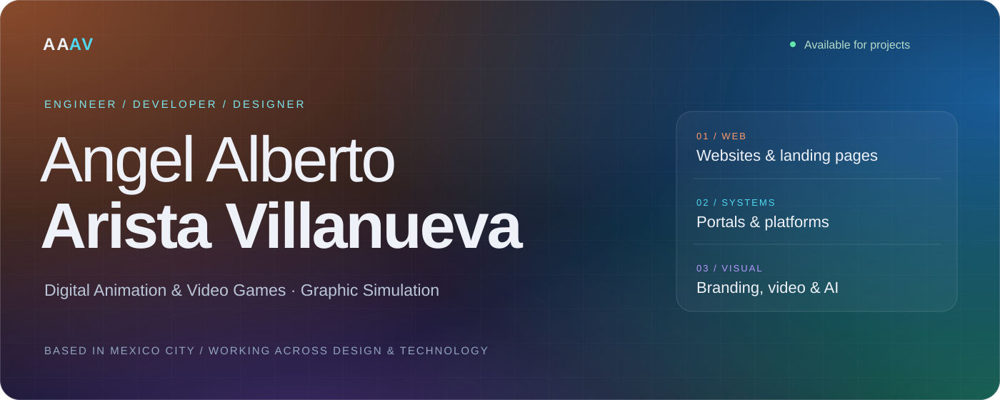

<picture>
  <source media="(max-width: 600px)" srcset="assets/profile-2026-mobile.svg">
  
</picture>

  <a href="https://skyblue-duck-237936.hostingersite.com/"><strong>Explore my portfolio ↗</strong></a> &nbsp;·&nbsp;
  <a href="https://skyblue-duck-237936.hostingersite.com/cv/CV_Angel_Arista_2026_EN.pdf">CV in English</a> &nbsp;·&nbsp;
  <a href="https://skyblue-duck-237936.hostingersite.com/cv/CV_Angel_Arista_2026_ES.pdf">CV en español</a> &nbsp;·&nbsp;
  <a href="mailto:angelalberto077@gmail.com">Let's talk</a>

## Design, code and the systems behind them

I'm **Angel**, an engineer in **Digital Animation and Video Games**, specializing in **Graphic Simulation**, based in **Mexico City**. I work across web development, branding, audiovisual production and digital marketing.

I build websites, landing pages and practical platforms, connect them to the tools a team uses, and take care of the hosting, domains and technical details that keep them running. My [portfolio](https://skyblue-duck-237936.hostingersite.com/) brings that work together with visual identity, animation and AI-assisted content.

**Web & interfaces** ? Websites, e-commerce and conversion landing pages built with React, TypeScript, Astro, HTML/CSS, WordPress and Elementor. GoHighLevel funnels for Google and Meta Ads.

**Platforms & infrastructure** ? Private portals, dashboards and ticket systems. PHP, MySQL, deployments, DNS, SSL, cPanel and hosting support.

**Creative & growth** ? Branding, motion graphics, video and AI-assisted content. Figma, Blender, Adobe and Affinity, supported by content strategy, GA4 and Tag Manager.

## Selected work

**[Entelequia Digital](https://entelequiadigital.com.mx)** · Technology direction and development of a bilingual agency website, a private influencer portal, and the team's [digital business cards](https://id.entelequiadigital.com.mx).

**[Central de Alarmas · Marketing](https://centraldealarmas.website/marketing.html)** · A ticket portal for the Marketing department, bringing requests and follow-up into one place.

**[QuiénOpina](https://quienopina.mx)** · Visual identity, editorial design and content strategy for an AI-powered social intelligence platform.

**[Geriactive](https://geriactive.mx)** · Website design and development for a center specializing in therapy for older adults, with clear information and accessible navigation.

**[Dr. Juan Carlos Arista](https://cuidadodeldolor.lovable.app)** · A medical platform for pain medicine and palliative care, with patient management, appointments, leads and balance tracking.

**[Soy Creación](https://azure-hornet-903083.hostingersite.com)** · An Astro website for guided hypnosis, breathwork and Kundalini experiences, with event and course pages generated from content files.

**Social content · September–December 2026**

Selected designs from the monthly content calendars for **GSI Seguridad Privada**, **Impacto Total** and **SEPSA Custodias**: posts, stories, complete carousels and format variants for Facebook, Instagram and LinkedIn. The [portfolio galleries](https://skyblue-duck-237936.hostingersite.com/#proyectos) include 87 selected visuals, organized by brand, month and format.

[**View all projects and case studies →**](https://skyblue-duck-237936.hostingersite.com/#proyectos) &nbsp;·&nbsp; [**Explore landing pages →**](https://skyblue-duck-237936.hostingersite.com/#landings)

<strong>More design, production and web work</strong>

- **[Vexel Digital](https://vexel.digital)** — Creative direction, web development, branding and audiovisual production.
- **[SecretBloom](https://eflora.lovable.app)** — Flower-shop e-commerce design and development.
- **Congreso Nacional de Marketing** — Visual identity and stage production for the artificial intelligence track.
- **Statega** — Corporate visual identity for a digital strategy agency.
- **GSI Seguridad Privada** — Campaign design and brand communication.
- **AX Transporter** — A promotional visual system for a tourist transfer brand.

[See the visual work in my portfolio →](https://skyblue-duck-237936.hostingersite.com/#proyectos)

## Paid media & analytics

Experience managing paid media campaigns with **Google Ads** and **Meta Ads**, measuring performance and conversions with **Google Analytics 4** and **Google Tag Manager**, and building dynamic reporting dashboards.

[**Try the interactive paid media dashboard →**](https://skyblue-duck-237936.hostingersite.com/#paid-media) — A clearly labeled demo with sample data: period and channel filters, spend, leads, CPL, CTR, GA4 sessions, simulated campaign budgets and status controls, and CSV export.

## Tools I work with

**Development** · TypeScript, React, Astro, HTML, CSS, JavaScript, PHP, MySQL, Git, WordPress, Elementor Pro, Kadence and GoHighLevel.

**Design & production** · Figma, Illustrator, Photoshop, Affinity, After Effects, Premiere Pro, Blender, Maya and Unreal Engine.

**AI & marketing** · Codex, Claude, Cursor, Gemini, Sora, Google Ads, Meta Ads, GA4 and Google Tag Manager.

## Code worth a look

| Repository | What you'll find |
| :--- | :--- |
| [Central-de-Alarmas](https://github.com/angelalberto0775859/Central-de-Alarmas) | Web development for Central de Alarmas |
| [gsi-seguridad-privada](https://github.com/angelalberto0775859/gsi-seguridad-privada) | A private security company's website |
| [export-elementor-pro-json](https://github.com/angelalberto0775859/export-elementor-pro-json) | An agent skill for generating and validating importable Elementor Pro JSON |
| [publicaciones](https://github.com/angelalberto0775859/publicaciones) | Social content and campaign work |
| [Paginasweb](https://github.com/angelalberto0775859/Paginasweb) | Web pages and front-end work |

[Browse all repositories →](https://github.com/angelalberto0775859?tab=repositories)

## Have a project in mind?

Open to freelance projects, collaborations and full-time roles. **English / Español.**

[**Portfolio & CV**](https://skyblue-duck-237936.hostingersite.com/) &nbsp;·&nbsp; [**LinkedIn**](https://www.linkedin.com/in/angel-alberto-arista-villanueva-617432208/) &nbsp;·&nbsp; [**WhatsApp**](https://wa.me/525625660729) &nbsp;·&nbsp; [**Email**](mailto:angelalberto077@gmail.com)

Mexico City, Mexico · Engineering, design and digital experiences.
